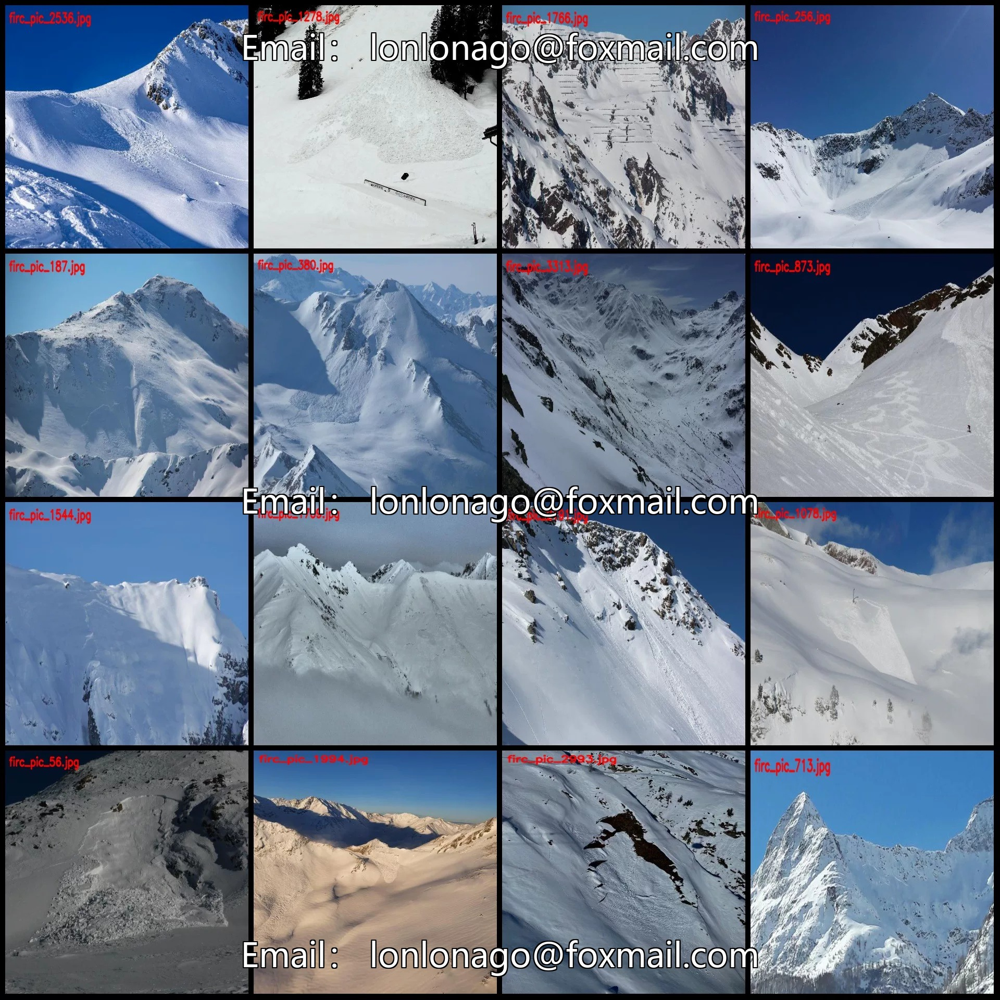
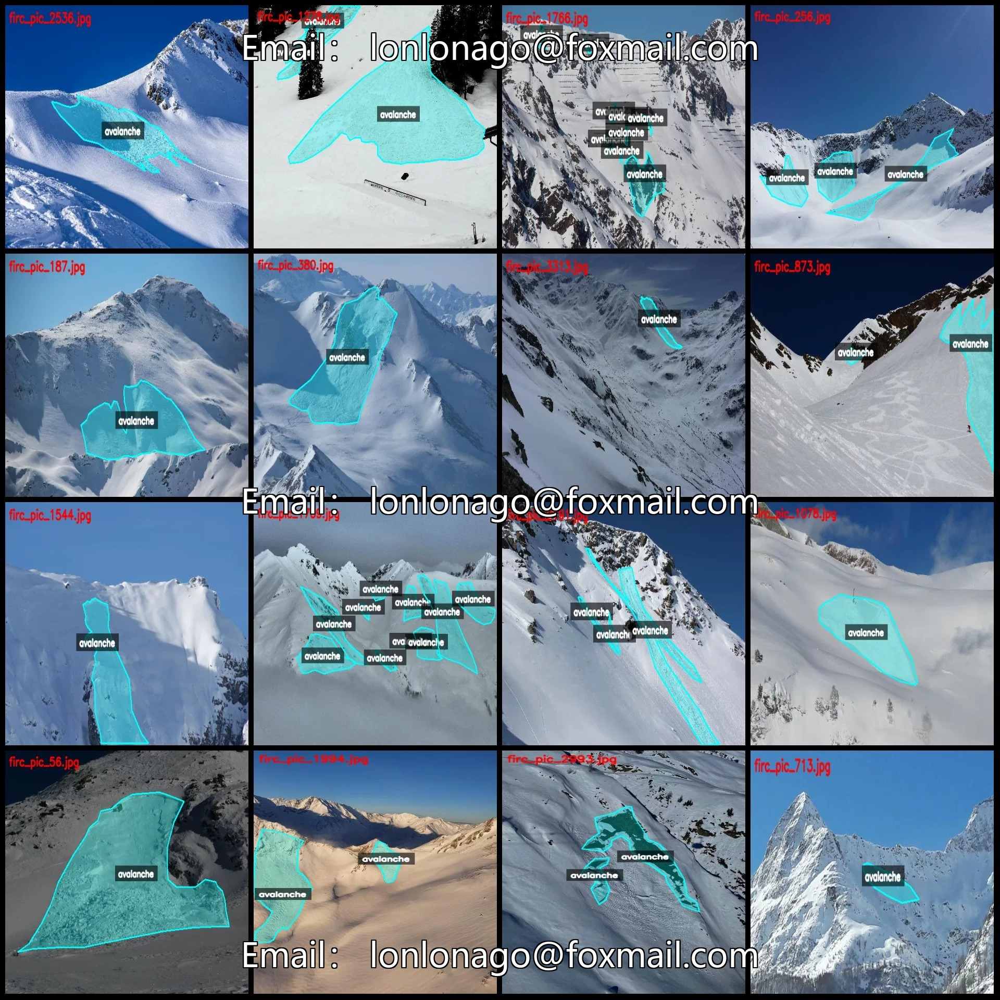
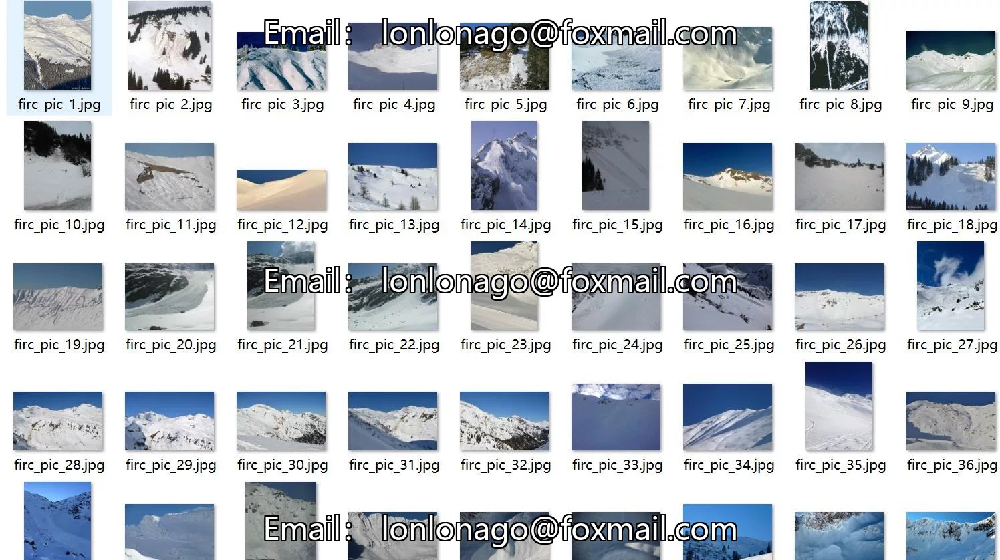
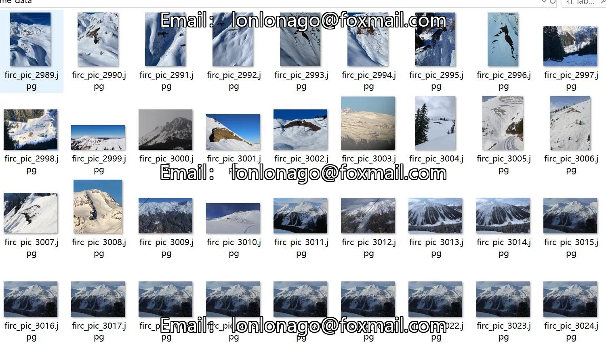
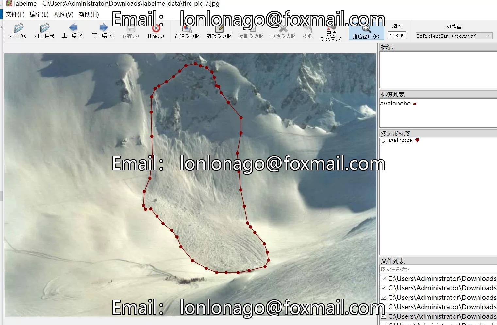
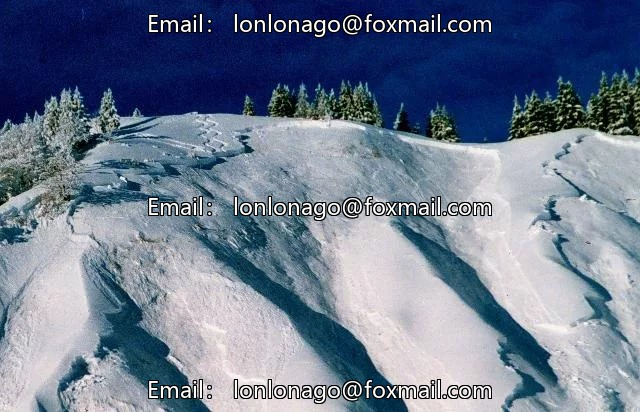
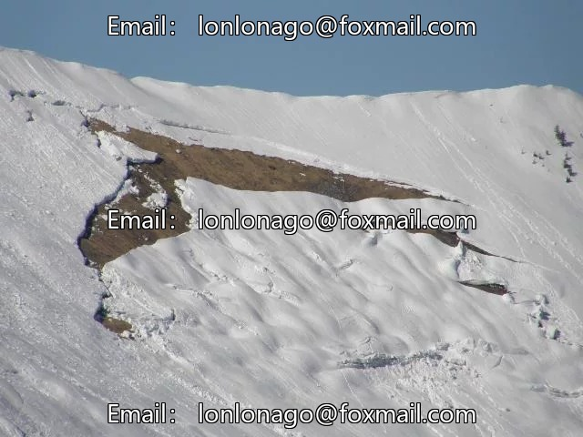
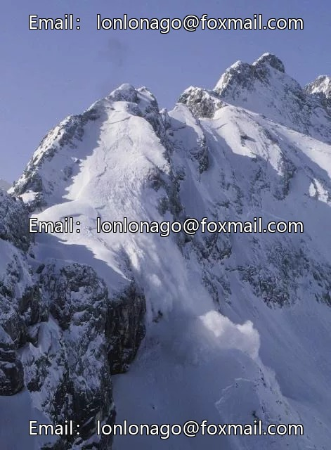

# Natural Disasters: Avalanche Identification and Segmentation Dataset - LabelMe format - 3351 images in 1 class

## Body

Natural Disasters: Avalanche Identification and Segmentation Dataset - LabelMe Format - 3351 Images in 1 Category

Warm Reminder: Due to the dataset's replicability, please confirm compliance with requirements before purchasing.

Dataset Format: LabelMe format (excluding mask files, only including jpg images and corresponding json files)
Number of Images (Total Number of JPG Files): 3351
Number of Annotations (Total Number of JSON Files): 3351
Number of Annotation Categories: 1
Annotation Category Name: ["avalanche"]
Each category has an equal number of bounding boxes and image counts.
Avalanche Bounding Boxes = 7582, Image Counts = 3351
Total Bounding Boxes: 7582
Annotation Tool Used: labelme=5.5.0

Image resolution: Multi-resolution images, such as 640x426, 640x480, etc.
Annotation rules: Polygons are drawn around the categories.
Important Note: The dataset can be opened and edited in LabelMe. JSON datasets need to be converted into mask or Yolo format or COCO format for semantic segmentation or instance segmentation.
Special : This dataset does not guarantee the accuracy of the trained models or weight files.

## Images

## Payment

Here is a pay link on Stripe ( https://buy.stripe.com/3cs8yP7sY87d0vu9AB ). Please contact me lonlonago@foxmail.com after funding $89, and I will send you a complete data files , thank you!

